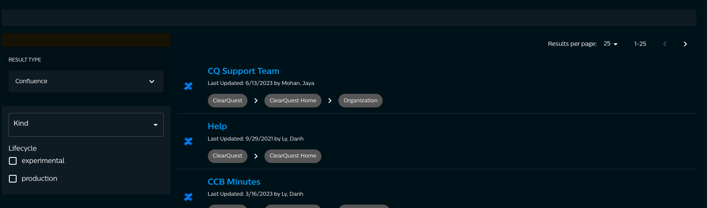

# Backstage Confluence Search Frontend Plugin

This frontend plugin integrates Confluence documents into Backstage search results. It adds a Confluence result type filter and renders Confluence search results with their last-updated details and ancestor breadcrumbs.

It is used in combination with its [backend counterpart](../search-confluence-backend/README.md).

Search Results:


## Installation

Add the package as a dependency of an app using the [new frontend system](https://backstage.io/docs/frontend-system/). Enable package discovery in `app-config.yaml`:

```yaml
app:
  packages: all
```

The plugin uses the [`SearchResultListItem` extension blueprint](https://backstage.io/docs/frontend-system/building-plugins/common-extension-blueprints/#searchresultlistitem---example), so no legacy search-page component registration or explicit extension configuration is required.
